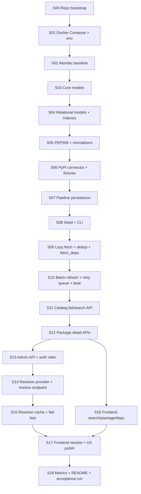

# PackageHub MVP — Execution Appendix

> Source of truth для плана реализации и последовательности поставки MVP.

**Source of truth:** [SPEC-MVP.md](./SPEC-MVP.md)  
**Версия:** 1.3-mvp-exec  
**Дата:** 2026-03-12

## 1. Принципы исполнения

- Размер среза: `0.5-1.0` рабочего дня.
- Каждый срез обязан иметь: objective, tasks, DoD, required tests, artifacts.
- Срез считается завершённым только после прохождения указанных тестов.
- Все контракты берутся из приложений `API` и `DB`, без расхождений.

`Decisions fixed`
- Реализация идёт по зависимостям срезов; перескок через незавершённые блокеры запрещён.

`Open questions`
- Нет.

## 2. Dependency Graph срезов

`Decisions fixed`
- Граф является обязательной последовательностью внедрения.

`Open questions`
- Нет.

## 3. Реализационные срезы

## S00 (0.5d) — Repo bootstrap

- Objective: подготовить рабочий каркас проекта и единый tooling baseline.
- Tasks:
  - создать директории backend/frontend и минимальные entrypoints;
  - добавить `.env.example` и базовый README skeleton.
- DoD:
  - репозиторий собирается структурно, команды запуска документированы.
- Required tests:
  - smoke: импорт backend app module;
  - smoke: запуск frontend dev server без runtime errors.
- Artifacts:
  - каркас папок и стартовые конфиги.

## S01 (0.5d) — Docker Compose + env

- Objective: поднять инфраструктурный контур MVP одной командой.
- Tasks:
  - описать `postgres`, `redis`, `api`, `worker`, `beat`, `frontend` в compose;
  - примонтировать `logs/` для `api`, `worker`, `beat`;
  - добавить healthchecks сервисов.
- DoD:
  - `docker compose up` поднимает весь стек;
  - `postgres`, `redis`, `api` выходят в `healthy`, остальные сервисы стартуют после healthy dependencies.
- Required tests:
  - compose smoke test;
  - health endpoint checks для stateful/public сервисов.
- Artifacts:
  - `docker-compose.yml`, env wiring.

## S02 (1.0d) — Alembic baseline

- Objective: создать миграционный baseline и enum-типы из DB appendix.
- Tasks:
  - инициализировать alembic;
  - добавить расширения и enum migrations.
- DoD:
  - `alembic upgrade head` успешно на пустой БД;
  - повторный запуск идемпотентен.
- Required tests:
  - migration integration test;
  - enum existence checks.
- Artifacts:
  - baseline migration files.

## S03 (1.0d) — Core models

- Objective: реализовать `registry`, `package`, `package_version`.
- Tasks:
  - SQLAlchemy модели + FK/unique ограничения;
  - seed строки `registry.slug=pypi`.
- DoD:
  - модели соответствуют `SPEC-MVP-DB.md`;
  - seed registry появляется после миграции.
- Required tests:
  - ORM model tests;
  - seed invariant test.
- Artifacts:
  - model modules + migration.

## S04 (1.0d) — Relational models + indexes

- Objective: внедрить остальные сущности и индексы.
- Tasks:
  - добавить `dependency`, `artifact`, `dist_tag`, `author*`, `vulnerability*`, `sync_state`, `sync_failure`;
  - создать обязательные индексы.
- DoD:
  - полный DB-контур MVP доступен;
  - индексы присутствуют в схеме.
- Required tests:
  - DB schema assertions;
  - index presence checks.
- Artifacts:
  - миграции и модели всех таблиц.

## S05 (1.0d) — PEP 508 + normalizers

- Objective: нормализовать входные метаданные PyPI.
- Tasks:
  - parser PEP 508 (`name/spec/extras/markers`);
  - normalizers: canonical name, license mapping SPDX.
- DoD:
  - parser покрывает version specs, extras, markers;
  - license mapping стабильно работает на fixtures.
- Required tests:
  - unit: parser edge cases;
  - unit: license alias mapping.
- Artifacts:
  - `normalizers/pep508.py`, `normalizers/license.py`, `normalizers/names.py`.

## S06 (1.0d) — PyPI connector + fixtures

- Objective: реализовать загрузку и нормализацию пакета из PyPI.
- Tasks:
  - connector `GET /pypi/{name}/json`;
  - retry/backoff policy для transient upstream ошибок;
  - fallback-нормализация vulnerability summary/details;
  - fixture-наборы (`flask`, `django`, `requests`, `numpy`).
- DoD:
  - connector возвращает `NormalizedPackage` со всеми необходимыми полями.
- Required tests:
  - unit: connector on fixtures;
  - nightly/live smoke (опционально).
- Artifacts:
  - `connectors/pypi.py`, test fixtures.

## S07 (1.0d) — Pipeline persistence

- Objective: реализовать идемпотентный pipeline записи в БД.
- Tasks:
  - `fetch -> normalize -> validate -> upsert* -> resolve(level1) -> synced_at`;
  - транзакционная обёртка per package.
- DoD:
  - повторный запуск для того же пакета не создаёт дублей;
  - `resolved_version_id` выставляется best-effort.
- Required tests:
  - integration: pipeline idempotency;
  - integration: rollback on package-level failure.
- Artifacts:
  - `fetcher/pipeline.py`.

## S08 (1.0d) — Seed + CLI

- Objective: добавить начальную загрузку seed-пакетов.
- Tasks:
  - Celery task seed;
  - CLI команды `seed`, `stats`, `fetch`;
  - чтение стартового списка из `SEED_PACKAGES`.
- DoD:
  - seed запускается и обновляет `sync_state`;
  - CLI команды работают локально.
- Required tests:
  - integration: seed on small package set;
  - CLI smoke tests.
- Artifacts:
  - `tasks/seed.py`, `app/cli.py`.

## S09 (1.0d) — Lazy fetch + dedup + fetch_deps

- Objective: on-demand загрузка неизвестных пакетов без дублей.
- Tasks:
  - `LazyFetcher.ensure_package` с in-flight дедупликацией;
  - фоновая задача рекурсивного дозаполнения зависимостей;
  - lazy hydrate зависимостей исторической версии при запросе package tree/resolve.
- DoD:
  - concurrent lazy fetch одного пакета не создаёт дублей;
  - unresolved зависимости дозаполняются фоновой задачей;
  - historical version tree не остаётся пустым только потому, что версия ещё не гидратирована.
- Required tests:
  - unit: dedup race test;
  - integration: lazy fetch + fetch_deps chain;
  - integration: version dependency hydrate on demand.
- Artifacts:
  - `fetcher/lazy.py`, `tasks/fetch_deps.py`.

## S10 (1.0d) — Batch refresh + retry queue + beat

- Objective: реализовать incremental sync по `synced_at`.
- Tasks:
  - Celery beat schedule `every 6h`;
  - Celery beat schedule `retry failed sync every 15m`;
  - refresh oldest `N` packages;
  - сохранять transient failures в `sync_failures`;
  - реализовать task `retry_failed`.
- DoD:
  - refresh обновляет `synced_at` даже без data changes;
  - статус отражается в `sync_state`;
  - retryable ошибки автоматически переходят в очередь повторов;
  - ручной `retry-failed` поднимает due-элементы без дублей.
- Required tests:
  - integration: refresh batch selection;
  - integration: sync_state updates;
  - integration: retry queue due selection/backoff;
  - integration: permanent vs retryable failure classification.
- Artifacts:
  - `tasks/refresh.py`, `tasks/retry_failed.py`, beat config, `services/sync_failures.py`.

## S11 (1.0d) — Catalog list/search API

- Objective: реализовать список пакетов и поиск с фильтрами/пагинацией.
- Tasks:
  - `GET /packages`, `GET /search`;
  - cursor pagination;
  - auth dependency (`viewer|admin`).
- DoD:
  - фильтры `license`, `has_vulnerabilities`, `updated_after`, `sort` работают.
- Required tests:
  - integration: pagination stability;
  - integration: filter correctness.
- Artifacts:
  - `api/v1/packages.py`, `api/v1/search.py`.

## S12 (1.0d) — Package detail APIs

- Objective: endpoint-ы карточки пакета и деревьев зависимостей.
- Tasks:
  - реализовать package/versions/version/dependencies/artifacts/vulnerabilities;
  - lazy fetch on 404 для package detail endpoint.
- DoD:
  - весь read-контур каталога соответствует API appendix.
- Required tests:
  - integration: package detail with lazy fetch;
  - integration: dependencies depth and marker filters.
- Artifacts:
  - расширение `api/v1/packages.py`.

## S13 (0.5d) — Admin API + auth roles

- Objective: запуск фоновых задач через admin endpoints и role-guarding.
- Tasks:
  - `POST /admin/seed`, `/admin/fetch/{name}`, `/admin/refresh`, `POST /admin/retry-failed`, `GET /admin/sync/status`;
  - enforcement `admin` role.
- DoD:
  - non-admin запросы получают `403`;
  - админские операции возвращают `202` + task info.
- Required tests:
  - integration: RBAC matrix;
  - integration: task trigger contracts.
- Artifacts:
  - `api/v1/admin.py`, auth policies.

## S14 (1.0d) — Resolver provider + endpoint

- Objective: подключить `resolvelib` и поднять `POST /resolve`.
- Tasks:
  - `PyPIProvider` (`identify`, `get_preference`, `find_matches`, `is_satisfied_by`, `get_dependencies`);
  - environment markers evaluation;
  - request/response schema resolve endpoint.
- DoD:
  - resolve типовых кейсов (`flask`, `django`) стабильно проходит.
- Required tests:
  - unit: provider methods;
  - integration: resolve endpoint success scenarios.
- Artifacts:
  - `resolver/provider.py`, `resolver/service.py`, `api/v1/resolve.py`.

## S15 (0.5d) — Resolver cache + fail-fast

- Objective: производительность и единая error политика resolver.
- Tasks:
  - in-process warm-up cache;
  - Redis cache layer для результатов resolve;
  - error mapping (`resolver_conflict`, `not_found`, `upstream_timeout`, `internal_error`).
- DoD:
  - повторный resolve обслуживается из cache;
  - при lazy fetch failure возвращается fail-fast error, без partial data.
- Required tests:
  - integration: cache hit/miss timings;
  - integration: fail-fast error behavior.
- Artifacts:
  - `resolver/cache.py`, error mappers.

## S16 (1.0d) — Frontend search/package/deps

- Objective: реализовать UI для поиска и карточки пакета.
- Tasks:
  - SearchPage с autocomplete, keyboard navigation и коротким description preview;
  - PackagePage с рендером нормализованного описания пакета;
  - PackagePage filters: `version`, `python`, `os`, `include_optional`;
  - синхронизация filters страницы пакета с query string;
  - compact dependency tree с badges условий и collapse/expand.
- DoD:
  - пользовательский путь поиска и просмотра пакета завершён;
  - карточка пакета открывается сразу в нужном filter-state по URL.
- Required tests:
  - UI integration tests (routing + data rendering);
  - UI integration: autocomplete interaction;
  - UI integration: package page query-param restore;
  - UI integration: tree collapse/expand;
  - UI integration: long raw description cleanup;
  - smoke на desktop/mobile viewport.
- Artifacts:
  - `frontend/src/pages/SearchPage.jsx`, `PackagePage.jsx`, shared UI helpers.

## S17 (1.0d) — Frontend resolve + UX polish

- Objective: закончить UI для resolve и связать с API.
- Tasks:
  - ResolvePage: форма зависимостей, `Input mode`, environment selectors, вывод дерева/ошибок;
  - compact tree в том же визуальном языке, что и package page;
  - collapse/expand дерева;
  - UX для `not_found`/`upstream_timeout`/`conflict`;
  - скрытие top-level roots, уже покрытых транзитивно в `freeze` mode.
- DoD:
  - end-to-end сценарий resolve работает в UI;
  - `requirements` и `pip freeze` modes дают предсказуемо разные top-level результаты.
- Required tests:
  - UI integration: resolve happy path;
  - UI integration: error rendering cases;
  - UI integration: freeze-mode hidden roots behavior;
  - UI integration: resolve tree collapse/expand.
- Artifacts:
  - `frontend/src/pages/ResolvePage.jsx`.

## S18 (1.0d) — Metrics + README + acceptance run

- Objective: финализировать MVP под приёмку.
- Tasks:
  - Prometheus метрики: sync duration, API latency, resolve latency, cache hit rate;
  - file logging runbook для `api/worker/beat`;
  - обновить README runbook;
  - прогнать acceptance suite.
- DoD:
  - все `AC-*` закрыты и подтверждены тестами;
  - стек поднимается одной командой и проходит smoke;
  - логи sync-ошибок доступны на host filesystem.
- Required tests:
  - full integration regression;
  - acceptance checklist run.
- Artifacts:
  - метрики, финальный README, отчёт приёмки.

`Decisions fixed`
- Срезы S00-S18 образуют минимально достаточный execution plan без дополнительных решений implementer-а.

`Open questions`
- Нет.

## 4. Матрица Acceptance Criteria -> owner slice

| Acceptance ID | Owner slice |
|---|---|
| AC-SYNC-1 | S08 |
| AC-SYNC-2 | S12 |
| AC-SYNC-3 | S09 |
| AC-SYNC-4 | S10 |
| AC-SYNC-5 | S07 |
| AC-SYNC-6 | S05 |
| AC-SYNC-7 | S05 |
| AC-SYNC-8 | S10 |
| AC-API-1 | S12 |
| AC-API-2 | S11 |
| AC-API-3 | S13 |
| AC-API-4 | S15 |
| AC-RES-1 | S14 |
| AC-RES-2 | S14 |
| AC-RES-3 | S15 |
| AC-RES-4 | S15 |
| AC-RES-5 | S15 |
| AC-UI-1 | S16 |
| AC-UI-2 | S16 |
| AC-UI-3 | S16 |
| AC-UI-4 | S17 |
| AC-INFRA-1 | S01 |
| AC-INFRA-2 | S01 |
| AC-INFRA-3 | S18 |
| AC-INFRA-4 | S18 |
| AC-INFRA-5 | S18 |

`Decisions fixed`
- У каждого AC есть ровно один owner slice для приёмки.

`Open questions`
- Нет.

## 5. Риски и правила управления изменениями

- Если API/DB контракт меняется, сначала обновляются `SPEC-MVP-API.md`/`SPEC-MVP-DB.md`, затем execution-срезы.
- Изменения scope во время реализации фиксируются через обновление `SPEC-MVP.md` и пере-привязку AC-owner.

`Decisions fixed`
- Execution appendix не переопределяет product decisions.

`Open questions`
- Нет.
